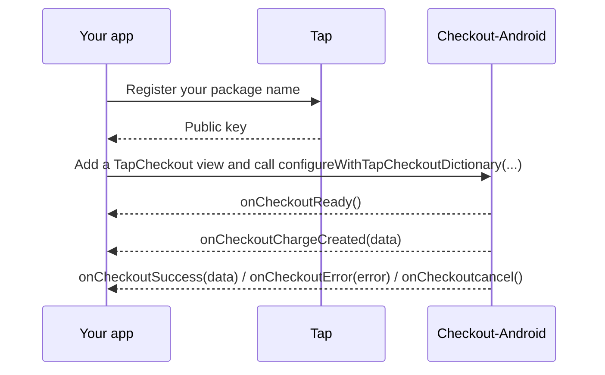

# Checkout-Android

Tap Payments' Android checkout SDK. Show a full Tap checkout in your app, collect a card or local payment method, and get the result back through a small delegate.


- [Requirements](#requirements)
- [How it works](#how-it-works)
- [Installation](#installation)
- [Permissions](#permissions)
- [Quick start](#quick-start)
- [Callbacks](#callbacks)
- [Configuration reference](#configuration-reference)
- [Charge vs Authorize](#charge-vs-authorize)
- [Sandbox vs production](#sandbox-vs-production)
- [Example app](#example-app)
- [Troubleshooting](#troubleshooting)

## Requirements

| | |
|---|---|
| Minimum Android | API 24 (Android 7.0) |
| Java / Kotlin | Java 11 bytecode, Kotlin 2.x |

> [!NOTE]
> Current release: **1.0.8**. Replace the version in the snippets below with the latest tag from the [releases page](https://github.com/Tap-Payments/Checkout-Android/tags).

## How it works



## Installation

The SDK is published on [JitPack](https://jitpack.io/#Tap-Payments/Checkout-Android). Add the repository in `settings.gradle`:

```groovy
dependencyResolutionManagement {
    repositories {
        google()
        mavenCentral()
        maven { url "https://jitpack.io" }
    }
}
```

Then the dependency in your app module's `build.gradle`:

```groovy
dependencies {
    implementation 'com.github.Tap-Payments:Checkout-Android:1.0.8'
}
```

With the Kotlin DSL (`settings.gradle.kts` / `build.gradle.kts`):

```kotlin
dependencyResolutionManagement {
    repositories {
        google()
        mavenCentral()
        maven("https://jitpack.io")
    }
}

dependencies {
    implementation("com.github.Tap-Payments:Checkout-Android:1.0.8")
}
```

## Permissions

The SDK's manifest already declares what it needs, and it is merged into your app automatically:

| Permission | Used for |
|---|---|
| `INTERNET`, `ACCESS_WIFI_STATE` | Loading the checkout |
| `CAMERA` | The card scanner. The SDK asks for it at runtime when the scanner opens. |
| `NFC` | Reading a card with NFC (`cardOptions.alternativeCardInputs.cardNFC`) |

## Quick start

1. Add a `TapCheckout` view to your layout.
2. Implement `TapCheckoutStatusDelegate`.
3. Build a configuration map and call `CheckoutConfiguration.configureWithTapCheckoutDictionary`.

```xml
<FrameLayout xmlns:android="http://schemas.android.com/apk/res/android"
    android:layout_width="match_parent"
    android:layout_height="match_parent">

    <!-- your screen -->

    <company.tap.tapcheckout_android.TapCheckout
        android:id="@+id/checkout"
        android:layout_width="match_parent"
        android:layout_height="match_parent"
        android:visibility="gone" />
</FrameLayout>
```

```kotlin
import company.tap.tapcheckout_android.CheckoutConfiguration
import company.tap.tapcheckout_android.TapCheckout
import company.tap.tapcheckout_android.TapCheckoutStatusDelegate

class CheckoutActivity : AppCompatActivity(), TapCheckoutStatusDelegate {

    private val checkout get() = findViewById<TapCheckout>(R.id.checkout)

    fun pay() {
        val publicKey = "pk_test_YOUR_PUBLIC_KEY"
        val configuration = hashMapOf<String, Any>(
            "gateway" to mapOf("publicKey" to publicKey),
            "language" to "en",
            "themeMode" to "light",
            "paymentType" to "ALL",
            "supportedPaymentMethods" to "ALL",
            "supportedCurrencies" to "ALL",
            "selectedCurrency" to "KWD",
            "amount" to 5,
            "customer" to mapOf(
                "firstName" to "Jane",
                "lastName" to "Doe",
                "email" to "jane@example.com",
                "phone" to mapOf("countryCode" to "965", "number" to "55567890"),
            ),
            "order" to mapOf(
                "currency" to "KWD",
                "amount" to 5,
                "items" to listOf(
                    mapOf("name" to "Item", "description" to "Item description",
                        "quantity" to 1, "amount" to 5, "currency" to "KWD"),
                ),
            ),
            "transaction" to mapOf(
                "mode" to "charge",
                "charge" to mapOf(
                    "saveCard" to true,
                    "threeDSecure" to true,
                    "redirect" to mapOf("url" to "https://example.com/checkout/return"),
                ),
            ),
        )

        // Shown in onCheckoutReady, so a page that is still loading never covers your screen.
        checkout.visibility = View.INVISIBLE
        CheckoutConfiguration.configureWithTapCheckoutDictionary(this, publicKey, checkout, configuration, this)
    }

    // TapCheckoutStatusDelegate
    override fun onCheckoutReady() { runOnUiThread { checkout.visibility = View.VISIBLE } }
    override fun onCheckoutChargeCreated(data: String) { Log.d("Checkout", "charge created: $data") }
    override fun onCheckoutSuccess(data: String) { Log.d("Checkout", "success: $data"); hide() }
    override fun onCheckoutError(error: String) { Log.d("Checkout", "error: $error"); hide() }
    override fun onCheckoutcancel() { hide() }

    private fun hide() = runOnUiThread { checkout.visibility = View.GONE }
}
```

Nested objects can be `Map`s and arrays `List`s (or `JSONObject` / `JSONArray`); the SDK turns the map into JSON.

> [!IMPORTANT]
> The checkout lives in **your** `TapCheckout` view, and the SDK never hides it. Show it in `onCheckoutReady` and hide it yourself when the flow ends (`onCheckoutSuccess`, `onCheckoutError`, `onCheckoutcancel`), as above.

> [!NOTE]
> `configureWithTapCheckoutDictionary` does not validate the configuration. Invalid or missing values are reported by the Tap backend inside the checkout or through `onCheckoutError`.

## Callbacks

`TapCheckoutStatusDelegate` has two required methods, `onCheckoutSuccess` and `onCheckoutError`; the others have empty default implementations. `data` / `error` is a **JSON string** produced by the checkout; parse it with `JSONObject` or your JSON library. Update your views from the main thread (`runOnUiThread`), as in the example above.

| Callback | Fires when | Argument |
|---|---|---|
| `onCheckoutReady()` | The checkout page finished loading and is ready for input. | none |
| `onCheckoutChargeCreated(data)` | A charge/authorization object was created. | JSON string |
| `onCheckoutSuccess(data)` | The checkout completed, including after a 3D Secure challenge. | JSON string (after 3DS: the charge id) |
| `onCheckoutError(error)` | The checkout failed or a network step failed. | JSON string (some errors are plain text) |
| `onCheckoutcancel()` | The user closed the checkout. Note the lowercase `c`. | none |
| `onCheckoutClick()` | The checkout page reported a click (its `onClick` event). | none |

> [!TIP]
> Treat `onCheckoutSuccess` as "the flow finished". After 3D Secure its payload is `{"chargeId":"chg_..."}`; confirm the final payment status on your server with the Retrieve Charge API ([Charges reference](https://developers.tap.company/reference/charges)) (`GET /v2/charges/{charge_id}`).

## Configuration reference

The configuration is a `HashMap<String, Any>` that mirrors the Tap web checkout demo. Dotted paths mean nested maps (`gateway.publicKey` is `"gateway" to mapOf("publicKey" to ...)`). Defaults are the values the example app sends, which match the web demo; "omit" means the key is not sent. The SDK itself reads only the `publicKey` argument, `themeMode` and `language`; everything else is forwarded to the Tap backend.

### SDK and gateway

| Key | Type | Values | Default |
|---|---|---|---|
| `gateway.publicKey` | String | Your Tap public key (`pk_test_...` / `pk_live_...`). Required; pass the same key as the `publicKey` argument. | none |
| `gateway.merchantId` | String | Merchant id associated with the key | omit |
| `hashString` | String | Hash generated on your server (see [Sandbox vs production](#sandbox-vs-production)) | `""` |
| `language` | String | `en`, `ar`, or `dynamic` (Android: the SDK replaces it with the device language) | `en` |
| `themeMode` | String | `light`, `dark`, `light_mono`, `dark_colored`, or `dynamic` (Android: the SDK replaces it with the device's light/dark mode) | `light` |
| `checkoutMode` | String | `popup` (bottom sheet), `page` (full screen) | `popup` |
| `paymentType` | String | `ALL`, `WEB`, `CARD`, `DEVICE` | `ALL` |
| `supportedPaymentMethods` | String or List | `"ALL"` or any of `AMERICAN_EXPRESS`, `APPLE_PAY`, `BENEFIT`, `BENEFITPAY`, `CAREEMPAY`, `FAWRY`, `GOOGLE_PAY`, `KNET`, `MADA`, `MASTERCARD`, `MEEZA`, `OMANNET`, `PAYPAL`, `POST_PAY`, `NAPS`, `STC_PAY`, `TABBY`, `VISA` | `"ALL"` |
| `selectedCurrency` | String | `KWD`, `BHD`, `SAR`, `AED`, `OMR`, `EGP`, `GBP`, `USD`, `EUR` | `SAR` |
| `supportedCurrencies` | String or List | `"ALL"`, `"AUTO"`, or a list of currency codes | `"ALL"` |
| `supportedRegions` | List | `LOCAL`, `REGIONAL`, `GLOBAL` | omit |
| `supportedCountries` | List | ISO alpha-2 country codes | omit |
| `supportedPaymentTypes` | List | `CARD`, `DEVICE_WALLET`, `EXPRESS_CHECKOUT_WALLET`, `PASS_THRU_WALLET`, `STORED_VALUE_WALLET`, `CASH_WALLET`, `BNPL` | omit |
| `supportedSchemes` | List | `BENEFIT`, `VISA`, `AMEX`, `MASTERCARD`, `MADA`, `MEEZA`, `OMANNET` | omit |
| `isApplePayAvailableOnClient` | Boolean | Sent by the web demo | `true` |
| `open` | Boolean | Always `true` (the web SDK adds it too) | `true` |

### Customer

| Key | Type | Notes |
|---|---|---|
| `customer.id` | String | Existing Tap customer id. Omit if empty. |
| `customer.firstName` | String | Required. |
| `customer.lastName` | String | Required unless `customer.id` is set. |
| `customer.email` | String | |
| `customer.phone.countryCode` | String | For example `965`. |
| `customer.phone.number` | String | Digits and `+`, at least 8 characters. |

### Card options

| Key | Type | Values | Default |
|---|---|---|---|
| `cardOptions.showBrands` | Boolean | | `true` |
| `cardOptions.showLoadingState` | Boolean | | `false` |
| `cardOptions.collectHolderName` | Boolean | | `true` |
| `cardOptions.preLoadCardName` | String | Pre-filled card holder name | `""` |
| `cardOptions.cardNameEditable` | Boolean | | `true` |
| `cardOptions.cardFundingSource` | String | `all`, `credit`, `debit` | `all` |
| `cardOptions.saveCardOption` | String | `all`, `merchant`, `tap`, `none` | `all` |
| `cardOptions.forceLtr` | Boolean | | `false` |
| `cardOptions.alternativeCardInputs.cardScanner` | Boolean | Shows the native card scanner button (uses the camera). | omit |
| `cardOptions.alternativeCardInputs.cardNFC` | Boolean | Shows the NFC card reader button (Android only). | omit |

### Order

| Key | Type | Notes |
|---|---|---|
| `amount` | Number | Order total: sum of `amount * quantity` over items, minus the discount. Must be greater than 0. |
| `order.id` | String | Your order reference. Default `""`. |
| `order.currency` | String | Same as `selectedCurrency`. |
| `order.amount` | Number | Same value as top-level `amount`. |
| `order.items[]` | List | At least one item. |
| `order.items[].name` | String | Min 2 characters. |
| `order.items[].description` | String | Min 2 characters. |
| `order.items[].quantity` | Number | Required. |
| `order.items[].amount` | Number | `>= 0`. |
| `order.items[].currency` | String | Same as `selectedCurrency`. |
| `order.discount.type` | String | `F` (fixed) or `P` (percentage). Send only when the value is greater than 0. |
| `order.discount.value` | Number | Discount value. |

### Transaction

| Key | Type | Values | Default |
|---|---|---|---|
| `transaction.mode` | String | `charge`, `authorize` | `charge` |
| `transaction.<mode>.threeDSecure` | Boolean | | `true` |
| `transaction.<mode>.saveCard` | Boolean | | `true` |
| `transaction.<mode>.redirect.url` | String | URL the 3D Secure / redirect flow returns to | none |
| `transaction.<mode>.auto.type` | String | `CAPTURE`, `VOID` (see [Charge vs Authorize](#charge-vs-authorize)) | `VOID` |
| `transaction.<mode>.auto.time` | Number | Hours before the automatic action | `100` |
| `transaction.<mode>.agreement.type` | String | `SCHEDULED`, `UNSCHEDULED` (recurring / saved agreements) | omit |
| `transaction.<mode>.agreement.amount_variability` | String | `FIXED`, `VARIABLE` (scheduled only) | `FIXED` |
| `transaction.<mode>.subscription.type` | String | `SCHEDULED` (not sent when the agreement type is `UNSCHEDULED`) | `SCHEDULED` |
| `transaction.<mode>.subscription.amount_variability` | String | `FIXED`, `VARIABLE` | `FIXED` |
| `transaction.<mode>.subscription.txn_count` | Number | Number of payments; `0` means undefined | `0` |
| `transaction.<mode>.airline.reference.booking` | String | Airline booking reference. `airline` is sent by default; leave it out to disable it. | `""` |

`<mode>` is the value of `transaction.mode`.

## Charge vs Authorize

`transaction.mode` decides what the checkout creates:

- `charge`: payment is captured immediately.
- `authorize`: funds are reserved and captured or voided later.

The settings for the transaction live in a sub-object **named after the mode**: `transaction.charge` for charges, `transaction.authorize` for authorizations. The inner fields are identical; only the key name changes. Use exactly one.

For authorizations, `auto` controls what happens if you do nothing:

- `auto.type`: `CAPTURE` captures the authorization automatically, `VOID` releases it.
- `auto.time`: hours to wait before that automatic action is applied (`100` in the web demo).

**Charge**

```json
{
  "transaction": {
    "mode": "charge",
    "charge": {
      "saveCard": true,
      "threeDSecure": true,
      "redirect": { "url": "https://example.com/checkout/return" }
    }
  }
}
```

**Authorize**

```json
{
  "transaction": {
    "mode": "authorize",
    "authorize": {
      "saveCard": true,
      "threeDSecure": true,
      "auto": { "type": "VOID", "time": 100 },
      "redirect": { "url": "https://example.com/checkout/return" }
    }
  }
}
```

The SDK itself handles both modes the same way and fires the same callbacks. To capture or void an authorization manually, call the Tap API **from your server** using the authorization id returned in the callback payload. See [developers.tap.company](https://developers.tap.company).

## Sandbox vs production

| | Sandbox | Production |
|---|---|---|
| Public key | `pk_test_...` | `pk_live_...` |
| Money moves | No | Yes |

- Switch environments by changing the public key. The Tap backend picks sandbox or production from the key.
- Use only your **public** key in the app. Never embed a secret key (`sk_...`) in an APK; it can be extracted.
- `hashString` must be generated on **your server** and passed to the app. Follow the [Tap documentation](https://developers.tap.company) for how to compute it; do not compute it with a secret key on the device.
- Keep keys out of source control: load them from build configuration or a remote config, not hard-coded literals in committed files.

## Example app

The [`app`](app) module is a minimal example that matches the iOS example apps: a **Start Checkout** button, a summary of what the next checkout will do, and a log of every callback. **Settings** mirrors every input of the Tap web demo and has a **Show configuration JSON** view that prints the exact map passed to the SDK.

Before running, open [`Keys.kt`](app/src/main/java/com/tap/company/checkout_android/Keys.kt) and replace the placeholder `YOUR_TAP_PUBLIC_KEY` with your own Tap public key, or enter it in Settings. Keys are not committed to the repository.

Then open the project in Android Studio and run the `app` configuration, or:

```bash
./gradlew :app:installDebug
```

The `com.google.gms.google-services` plugin is applied to the example app, so it needs an `app/google-services.json` to build. It is not committed; use your own Firebase file.

**Sandbox test card (3D Secure)**

| Card number | Expiry | CVV |
|---|---|---|
| 4508 7500 1574 1019 | 01/39 | 100 |

## Troubleshooting

| Problem | Fix |
|---|---|
| The screen behind the checkout can't be tapped, nothing shows | The `TapCheckout` view is visible while the page is still loading (or failed to load). Keep it invisible until `onCheckoutReady`, and hide it on success, error and cancel. |
| The checkout takes long to appear the first time | The page and its assets load from Tap's CDN; on a slow network the first `onCheckoutReady` can take a while. Check connectivity. |
| Blank checkout, nothing happens | Check connectivity and that the public key is valid. |
| Camera permission denied | The scanner cannot open. Ask the user to allow the camera in the system settings. |
| `onCheckoutError` arrives some minutes after `onCheckoutSuccess` (`"Card loading timeout"`) | The page's timer ran out in the background after the flow finished. Ignore errors that arrive after you have handled a success. |
| No callbacks arrive | Pass your delegate as the last argument of `configureWithTapCheckoutDictionary` and keep the activity alive while the checkout is open. |
